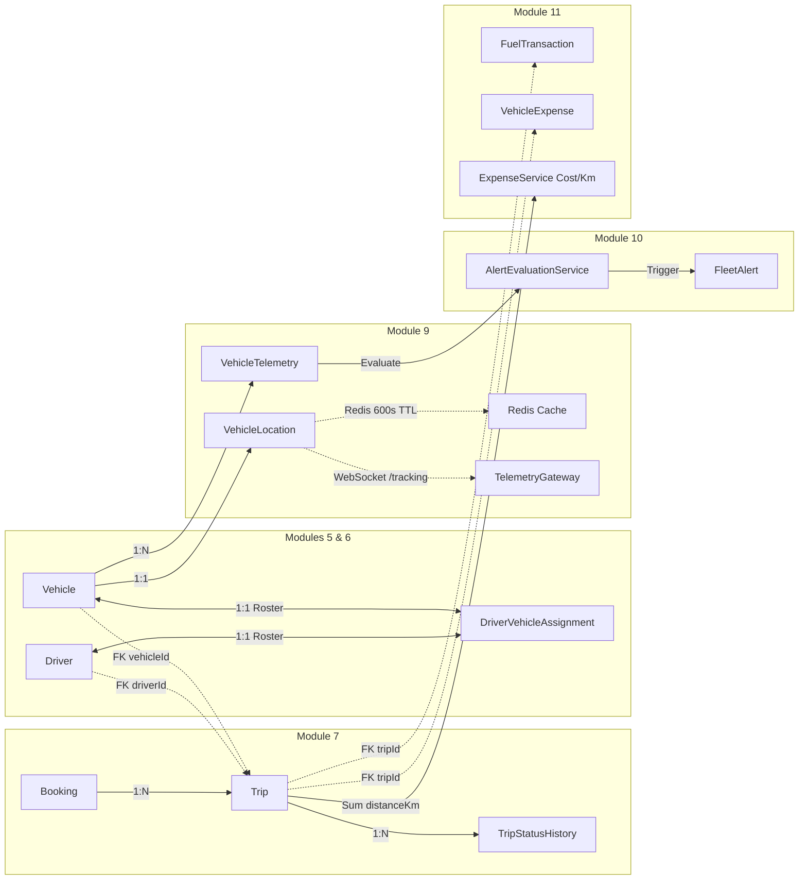

# AI-MOS — MODULE 12: ARCHITECTURE VERIFICATION & REQUIREMENTS BASELINE

> **Status:** ARCHITECTURE VERIFIED & REQUIREMENTS FROZEN  
> **Target Package:** `apps/backend-api`, `packages/database`, `packages/types`, `packages/constants`, `apps/admin-web`  
> **Regression Constraint:** All 310 existing automated tests (Modules 1–11) MUST remain strictly passing.  
> **Implementation State:** NO code, migrations, or database changes applied in this phase.

---

## 1. Executive Summary

Module 12 serves as the operational bridge connecting **Demand** (Bookings & Trips, Modules 3 & 7), **Asset Resources** (Vehicles & Drivers, Modules 5 & 6), **Live Telemetry & Safety** (Tracking & Geofencing, Modules 9 & 10), and **Asset Financials** (Fuel, Maintenance & TCO, Module 11).

Prior architectural summaries posited several proposed models (`TripStop`, `DispatchAssignment`, `RoutePlan`, `RouteSegment`, `ServiceArea`) and assumed dynamic lifecycle hooks (such as automatic odometer propagation and dynamic ETA calculation upon trip completion). A rigorous audit of the active codebase confirms:

1. **Foundations Already Exist:** Robust baseline models for `Booking`, `Trip`, `TripStatusHistory`, `Driver`, `DriverVehicleAssignment`, `Vehicle`, `VehicleLocation`, `VehicleTelemetry`, and `FleetAlert` are fully functional and in production.
2. **Dispatch is Partially Implemented:** `TripService` supports assigning drivers and vehicles, and transitioning trips to `DISPATCHED` and execution states. However, it lacks time-window overlap conflict validation, unassignment endpoints, multi-stop waypoint management, and routing/ETA engine integration.
3. **Over-Engineering Must Be Prevented:** Proposed entities such as `DispatchAssignment` and `RouteSegment` represent redundant abstractions that duplicate `Trip` assignment fields and risk bloating the PostgreSQL database.
4. **WebSocket Gap Identified:** While `TelemetryGateway` streams live GPS coordinates and alerts, trip assignment and dispatch events currently execute silently without broadcasting WebSocket messages to the dispatch board.

This document establishes the verified baseline for Module 12, defining strict boundaries, eliminating duplication, formalizing state transitions, and outlining an implementation roadmap.

---

## 2. Verified Existing Architecture

```
┌─────────────────────────────────────────────────────────────────────────────┐
│                             AI-MOS MONOREPO                                 │
├───────────────────────────────┬─────────────────────────────────────────────┤
│ apps/backend-api              │ NestJS API Gateway & Domain Services         │
│ apps/admin-web                │ Next.js 14 App Router Management Dashboard  │
│ packages/database             │ Prisma ORM (v5.17) + PostgreSQL Migration DB│
│ packages/constants            │ System constants, enums, permission matrix  │
│ packages/types                │ Shared TypeScript DTOs and contracts        │
│ packages/utils                │ Shared formatting, mathematical utilities   │
└───────────────────────────────┴─────────────────────────────────────────────┘
```

### Module Cross-Linkages in Active Code



---

## 3. Existing Models (Verified from `packages/database/prisma/schema.prisma`)

### A. Booking System (`Booking`)
- **Table:** `bookings` (Line 851)
- **Key Fields:**
  - `id` (`UUID`), `companyId` (`UUID`), `customerId` (`UUID?`, references `User`)
  - `bookingNumber` (`String`, e.g., `BKG-0001`, unique per company)
  - `source` (`BookingSource`: `MANUAL`, `ONLINE`, `CORPORATE`, `PHONE`, `APP`, `OTHER`)
  - `tripType` (`TripType`: `ONE_WAY`, `ROUND_TRIP`, `RENTAL`, `AIRPORT_TRANSFER`, `OUTSTATION`)
  - `customerName`, `customerPhone`, `customerEmail`
  - `pickupLocation`, `pickupAddress`, `pickupLatitude`, `pickupLongitude`
  - `dropLocation`, `dropAddress`, `dropLatitude`, `dropLongitude`
  - `scheduledPickupAt` (`DateTime`), `estimatedDurationMinutes` (`Int?`), `estimatedDistanceKm` (`Float?`)
  - `passengerCount` (`Int`, default 1), `luggageCount` (`Int`), `vehicleCategory` (`String?`)
  - `status` (`BookingStatus`: `PENDING`, `CONFIRMED`, `CANCELLED`, `EXPIRED`, `COMPLETED`)
  - `estimatedFare` (`Decimal(12,2)?`), `notes`, `createdBy` (`UUID?`)
- **Indexes:** `[companyId]`, `[companyId, status]`, `[scheduledPickupAt]`, `[customerId]`, `[deletedAt]`

### B. Trip System (`Trip`)
- **Table:** `trips` (Line 918)
- **Key Fields:**
  - `id` (`UUID`), `companyId` (`UUID`), `bookingId` (`UUID`, mandatory foreign key)
  - `driverId` (`UUID?`, references `Driver`), `vehicleId` (`UUID?`, references `Vehicle`)
  - `tripNumber` (`String`, e.g., `TRP-0001`, unique per company)
  - `pickupLocation`, `pickupAddress`, `pickupLatitude`, `pickupLongitude`
  - `dropLocation`, `dropAddress`, `dropLatitude`, `dropLongitude`
  - `scheduledStart` (`DateTime`), `actualStart` (`DateTime?`), `actualEnd` (`DateTime?`)
  - `distanceKm` (`Float?`), `durationMinutes` (`Int?`), `passengerCount` (`Int`)
  - `status` (`TripStatus`: `SCHEDULED`, `DRIVER_ASSIGNED`, `VEHICLE_ASSIGNED`, `DISPATCHED`, `DRIVER_ARRIVED`, `PASSENGER_ONBOARD`, `IN_PROGRESS`, `COMPLETED`, `CANCELLED`, `NO_SHOW`)
  - `cancellationReason`, `cancelledBy` (`UUID?`), `cancelledAt` (`DateTime?`), `notes`
- **Relations:** `booking`, `driver`, `vehicle`, `statusHistory`, `fleetAlerts`, `fuelTransactions`, `vehicleExpenses`
- **Indexes:** `[companyId]`, `[companyId, status]`, `[bookingId]`, `[driverId]`, `[vehicleId]`, `[scheduledStart]`, `[deletedAt]`

### C. Trip Status History (`TripStatusHistory`)
- **Table:** `trip_status_histories` (Line 983)
- **Fields:** `id`, `tripId`, `companyId`, `fromStatus`, `toStatus`, `changedBy`, `notes`, `latitude`, `longitude`, `createdAt`

### D. Driver System (`Driver`, `DriverDutyLog`, `DriverVehicleAssignment`)
- **`Driver`:** `id`, `companyId`, `employeeId` (`UUID?`), `driverCode`, `licenseNumber`, `licenseType` (`LMV`, `HMV`, `COMMERCIAL`, `TRANSPORT`, `OTHER`), `licenseIssueDate`, `licenseExpiryDate`, `badgeNumber`, `status` (`DriverStatus`: `ACTIVE`, `INACTIVE`, `SUSPENDED`, `TERMINATED`), `dutyStatus` (`DriverDutyStatus`: `OFF_DUTY`, `ON_DUTY`, `ON_TRIP`, `ON_BREAK`, `UNAVAILABLE`)
- **`DriverDutyLog`:** Tracks shift punch-ins/outs with `startedAt`, `endedAt`, `status`, `notes`.
- **`DriverVehicleAssignment`:** Tracks dedicated driver-vehicle pairing with `driverId`, `vehicleId`, `isActive` (`Boolean`).

### E. Vehicle System (`Vehicle`)
- **Table:** `vehicles` (Line 523)
- **Key Fields:** `id`, `companyId`, `vehicleNumber`, `make`, `model`, `year`, `fuelType`, `ownership`, `status` (`VehicleStatus`: `ACTIVE`, `INACTIVE`, `MAINTENANCE`, `RETIRED`, `ON_TRIP`), `capacity` (`Int?`), `odometer` (`Int`), `registrationExpiry`, `insuranceExpiry`
- **Critical Finding:** `AVAILABLE` is **NOT** an enum value in `VehicleStatus`. The operational active state is `ACTIVE`.

### F. Telemetry Models (`VehicleLocation`, `VehicleTelemetry`)
- **`VehicleLocation`:** Hot-path single row per vehicle (`vehicleId` unique). Contains `latitude`, `longitude`, `speed`, `heading`, `accuracy`, `altitude`, `ignition`, `batteryLevel`, `odometer`, `engineTemperature`, `fuelLevel`, `signalStrength`, `timestamp`.
- **`VehicleTelemetry`:** Append-only event history with identical telemetry fields.

---

## 4. Existing Services (Verified from Source Code)

### `TripService` ([trip.service.ts](file:///d:/Mobility/apps/backend-api/src/modules/trip/trip.service.ts))
| Method | Verification & Behavior |
| :--- | :--- |
| `createTrip` | **[EXISTS]** Auto-creates linked `Booking` if `bookingId` is not provided. Validates driver/vehicle eligibility. Computes initial status (`SCHEDULED`, `DRIVER_ASSIGNED`, `VEHICLE_ASSIGNED`). |
| `listTrips` | **[EXISTS]** Supports filtering by status, tripType, driverId, vehicleId, date ranges, and search. |
| `getStats` | **[EXISTS]** Returns aggregated counts by operational status. |
| `getTrip` | **[EXISTS]** Returns full trip details with booking, vehicle, driver, and status history. |
| `updateTrip` | **[EXISTS]** Updates route addresses, coordinates, scheduled times, passenger count, notes. Rejects completed/cancelled trips. |
| `assignDriver` | **[EXISTS]** Validates eligibility, updates `driverId`, transitions status (`SCHEDULED` $\to$ `DRIVER_ASSIGNED`), writes history and audit log. |
| `assignVehicle` | **[EXISTS]** Validates eligibility, updates `vehicleId`, transitions status (`SCHEDULED` $\to$ `VEHICLE_ASSIGNED`), writes history and audit log. |
| `dispatchTrip` | **[EXISTS]** Enforces that both `driverId` and `vehicleId` are assigned. Transitions status to `DISPATCHED`. |
| `updateTripStatus` | **[EXISTS]** Enforces `VALID_TRIP_TRANSITIONS`. Synchronizes `driver.dutyStatus` (`ON_TRIP` on `IN_PROGRESS`, `ON_DUTY` on `COMPLETED`/`CANCELLED`). Synchronizes `booking.status` (`COMPLETED` on trip completion). |
| `deleteTrip` | **[EXISTS]** Soft-deletes trip. Blocks deletion if `IN_PROGRESS` or `DISPATCHED`. |
| `validateDriverEligibility` | **[EXISTS]** Enforces `driver.status === 'ACTIVE'`, license non-expired, and checks active trips (`DISPATCHED`, `DRIVER_ARRIVED`, `PASSENGER_ONBOARD`, `IN_PROGRESS`). |
| `validateVehicleEligibility` | **[EXISTS]** Enforces `vehicle.status === 'ACTIVE'`, checks active trips (`DISPATCHED`, `DRIVER_ARRIVED`, `PASSENGER_ONBOARD`, `IN_PROGRESS`). |

### `BookingService` ([booking.service.ts](file:///d:/Mobility/apps/backend-api/src/modules/booking/booking.service.ts))
- Implements `createBooking`, `listBookings`, `getStats`, `getBooking`, `updateBooking`, `confirmBooking`, `cancelBooking`, `deleteBooking`.

### `DriverService` ([driver.service.ts](file:///d:/Mobility/apps/backend-api/src/modules/driver/driver.service.ts))
- Implements full driver profile management, license validations, `dutyStatus` updates, `DriverDutyLog` history, and dedicated `DriverVehicleAssignment` pairing.

### `VehicleService` ([vehicle.service.ts](file:///d:/Mobility/apps/backend-api/src/modules/vehicle/vehicle.service.ts))
- Implements vehicle registry, documents, maintenance records (legacy Module 5), and status transitions.

### `TelemetryService` ([telemetry.service.ts](file:///d:/Mobility/apps/backend-api/src/modules/telemetry/telemetry.service.ts))
- Ingests GPS point streams, checks active trip (`db.trip.findFirst`), caches latest location in Redis (`tracking:vehicle:{id}:location`), broadcasts over WebSockets, and evaluates geofence/safety alerts.

---

## 5. Existing APIs (Verified from Controller Files)

| Method | Endpoint | Guards & Permissions | Description |
| :--- | :--- | :--- | :--- |
| `POST` | `/trips` | `TenantGuard`, `CompanyRoles(OWNER, ADMIN, MANAGER)` | Create trip (auto-creates booking if omitted) |
| `GET` | `/trips` | `TenantGuard` | List trips (pagination, filtering, sorting) |
| `GET` | `/trips/stats` | `TenantGuard` | Aggregated trip metrics by status |
| `GET` | `/trips/:id` | `TenantGuard` | Get full trip detail |
| `PATCH` | `/trips/:id` | `TenantGuard`, `CompanyRoles(OWNER, ADMIN, MANAGER)` | Update trip details |
| `POST` | `/trips/:id/assign-driver` | `TenantGuard`, `CompanyRoles(OWNER, ADMIN, MANAGER)` | Assign driver to trip |
| `POST` | `/trips/:id/assign-vehicle` | `TenantGuard`, `CompanyRoles(OWNER, ADMIN, MANAGER)` | Assign vehicle to trip |
| `POST` | `/trips/:id/dispatch` | `TenantGuard`, `CompanyRoles(OWNER, ADMIN, MANAGER)` | Dispatch trip (requires driver + vehicle) |
| `PATCH` | `/trips/:id/status` | `TenantGuard`, `CompanyRoles(OWNER, ADMIN, MANAGER, MEMBER)` | Update trip execution status |
| `DELETE` | `/trips/:id` | `TenantGuard`, `CompanyRoles(OWNER, ADMIN)` | Soft-delete trip |

---

## 6. Existing Frontend (Verified from `apps/admin-web`)

- **Dispatch Board:** Located at `apps/admin-web/app/(dashboard)/companies/[companyId]/dispatch/page.tsx`
  - Guarded by `<RouteGuard requiredPermission="trip.dispatch">`.
  - Kanban layout partitioning trips into:
    1. *Needs Assignment* (`SCHEDULED`, `DRIVER_ASSIGNED`, `VEHICLE_ASSIGNED` missing one entity)
    2. *Ready to Dispatch* (Both driver and vehicle assigned, status `SCHEDULED`/`DRIVER_ASSIGNED`/`VEHICLE_ASSIGNED`)
    3. *Active / In Progress* (`DISPATCHED`, `DRIVER_ARRIVED`, `PASSENGER_ONBOARD`, `IN_PROGRESS`)
    4. *Completed Today* (`COMPLETED`, `CANCELLED`)
  - Supports quick dispatch button and status progression buttons.
  - **Limitation:** Data loading is strictly pull-based via HTTP polling or manual page refresh; it does not listen to WebSocket dispatch events.

---

## 7. Existing Socket.IO Architecture

- **Gateway:** `TelemetryGateway` ([telemetry.gateway.ts](file:///d:/Mobility/apps/backend-api/src/modules/telemetry/telemetry.gateway.ts))
- **Namespace:** `/tracking`
- **Rooms:**
  - `company:{companyId}`: Tenant isolation room joined upon authenticated connection.
  - `vehicle:{vehicleId}`: Vehicle-specific subscription room.
- **Broadcast Events Currently Emitted:**
  - `vehicle:location_updated`
  - `vehicle:status_updated`
  - `driver:location_updated`
  - `trip:location_updated`
  - `alert:created`, `alert:updated`, `alert:acknowledged`, `alert:resolved`
- **Critical Gap:** No dispatch or assignment events (`dispatch:trip_assigned`, `dispatch:trip_dispatched`, `dispatch:trip_status_changed`) are broadcast when `TripService` executes assignments or status updates.

---

## 8. Existing Redis Key Architecture

- **`tracking:vehicle:{vehicleId}:location`**: Caches latest `VehicleLocationDto` (TTL: 600s).
- **`fleet:maintenance:reminder:{scheduleId}:{status}`**: Prevents duplicate maintenance reminder alerts (TTL: 86400s).
- **`geofence:state:{vehicleId}:{geofenceId}`**: Caches geofence inside/outside state for hysteresis (TTL: 86400s).

---

## 9. Existing Permission Matrix (Verified)

Defined in [packages/constants/src/permissions.ts](file:///d:/Mobility/packages/constants/src/permissions.ts) and [trip.ts](file:///d:/Mobility/packages/constants/src/trip.ts):
- `trip.read`
- `trip.create`
- `trip.update`
- `trip.delete`
- `trip.assign.driver`
- `trip.assign.vehicle`
- `trip.dispatch`
- `trip.update.status`
- `trip.cancel`

Default Roles with Full Dispatch Access: `OWNER`, `ADMIN`, `MANAGER`, `DISPATCHER`.

---

## 10. Verified Gaps Analysis

| Feature / Requirement | Current Code Status | Verification Detail | Action Required for Module 12 |
| :--- | :---: | :--- | :--- |
| **Driver Assignment** | **[EXISTS]** | `assignDriver` in `TripService` | Keep existing logic; add unassignment endpoint. |
| **Vehicle Assignment** | **[EXISTS]** | `assignVehicle` in `TripService` | Keep existing logic; add unassignment endpoint. |
| **Time-Window Conflict Check** | **[DOES NOT EXIST]** | Only checks active running trips (`IN_PROGRESS`, etc.). Does not check overlapping scheduled times for upcoming trips. | **BUILD**: Add time-window overlap collision check (`scheduledStart` $\pm$ duration). |
| **Maintenance Hold Conflict** | **[PARTIAL]** | Checks `vehicle.status !== 'ACTIVE'`, but does not check Module 11 `WorkOrder` status `IN_PROGRESS`. | **BUILD**: Check active `WorkOrder` rows in vehicle validation. |
| **Driver Unassignment** | **[DOES NOT EXIST]** | No endpoint to unassign a driver from a scheduled trip. | **BUILD**: Add `POST /trips/:id/unassign-driver`. |
| **Vehicle Unassignment** | **[DOES NOT EXIST]** | No endpoint to unassign a vehicle from a scheduled trip. | **BUILD**: Add `POST /trips/:id/unassign-vehicle`. |
| **Multi-Stop Waypoints** | **[DOES NOT EXIST]** | Trip model only has pickup & dropoff coordinates. No waypoints model exists. | **BUILD**: Create minimal `TripStop` model. |
| **Routing Provider & Geometry** | **[DOES NOT EXIST]** | No routing provider interface, no distance/duration calculation from coordinates. | **BUILD**: Create pluggable `RoutingProvider` interface with Mock/OSRM implementation. |
| **Dynamic ETA Engine** | **[DOES NOT EXIST]** | No dynamic ETA engine. Durations are static integers. | **BUILD**: Compute ETAs from route provider + live GPS distance. |
| **Real-Time Dispatch Sockets** | **[DOES NOT EXIST]** | `TripService` does not emit WebSocket events to the gateway. | **BUILD**: Inject `TelemetryGateway` (or Dispatch Gateway) and broadcast dispatch events. |
| **Interactive Dispatch Board** | **[PARTIAL]** | Basic Kanban exists in `apps/admin-web/.../dispatch/page.tsx`, but no live socket updates, no map drawer, no conflict indicators. | **BUILD**: Enhance frontend dispatch board with live socket listener and conflict warnings. |

---

## 11. Module 12 Scope

```
┌─────────────────────────────────────────────────────────────────────────────┐
│                           MODULE 12 SCOPE BOUNDARY                          │
├────────────────────────────────┬────────────────────────────────────────────┤
│ MUST HAVE (Module 12 Core)     │ • Time-window overlap collision engine     │
│                                │ • Unassignment & Reassignment endpoints    │
│                                │ • Module 11 Active WorkOrder hold check    │
│                                │ • Minimal TripStop model for multi-stop    │
│                                │ • Pluggable RoutingProvider interface      │
│                                │ • Route calculation & ETA service          │
│                                │ • Real-time Dispatch Socket.IO events      │
│                                │ • Enhanced Dispatch Board UI               │
├────────────────────────────────┼────────────────────────────────────────────┤
│ SHOULD HAVE (Phase 2 Polish)   │ • Driver dispatch recommendation scoring   │
│                                │ • Route deviation alert detection          │
├────────────────────────────────┼────────────────────────────────────────────┤
│ FUTURE (Later Modules)         │ • Multi-vehicle Route Optimization (VRP)   │
│                                │ • Driver self-dispatch / bidding portal    │
└────────────────────────────────┴────────────────────────────────────────────┘
```

---

## 12. What Module 12 Must NOT Build (Explicit Exclusions)

Module 12 will **NOT**:
1. Re-create or modify the `Booking` system.
2. Re-create or duplicate the `Trip` table.
3. Create a separate `DispatchAssignment` table (assignment lives directly on `Trip`).
4. Create micro-level `RouteSegment` rows for every GPS point (store geometry as encoded polyline on `Trip`).
5. Create a separate `ServiceArea` table (Module 10 `Geofence` satisfies spatial fencing).
6. Build a new WebSocket gateway (reuse existing `/tracking` namespace on `TelemetryGateway`).
7. Create a new Authentication or RBAC system.
8. Duplicate vehicle maintenance or expense logic from Module 11.

---

## 13. Proposed Domain Model

Only **ONE** new database model is required for Module 12:

### `TripStop` Model
```prisma
/// Sequenced waypoints/stops for multi-stop trips
enum StopType {
  PICKUP
  WAYPOINT
  DROPOFF
}

enum StopStatus {
  PENDING
  ARRIVED
  COMPLETED
  SKIPPED
}

model TripStop {
  id              String     @id @default(dbgenerated("gen_random_uuid()")) @db.Uuid
  companyId       String     @db.Uuid
  tripId          String     @db.Uuid

  stopOrder       Int        // 1-indexed execution sequence
  stopType        StopType   @default(WAYPOINT)
  locationName    String
  address         String?
  latitude        Float
  longitude       Float

  plannedArrival  DateTime?
  plannedDeparture DateTime?
  actualArrival   DateTime?
  actualDeparture DateTime?

  passengerName   String?
  passengerPhone  String?
  notes           String?
  status          StopStatus @default(PENDING)

  createdAt       DateTime   @default(now())
  updatedAt       DateTime   @updatedAt

  company         Company    @relation(fields: [companyId], references: [id], onDelete: Cascade)
  trip            Trip       @relation(fields: [tripId], references: [id], onDelete: Cascade)

  @@unique([tripId, stopOrder])
  @@index([companyId])
  @@index([tripId])
  @@index([status])
  @@map("trip_stops")
}
```

### Additions to Existing `Trip` Model (Non-Breaking)
```prisma
// Added to model Trip:
routePolyline       String?    @db.Text   // Encoded polyline geometry for map rendering
estimatedDistanceKm Float?                // Provider-calculated route distance
estimatedDurationMinutes Int?             // Provider-calculated route duration
stops               TripStop[]            // Relation to stops
```

---

## 14. State Machines

### A. Operational Trip State Machine
```
   ┌───────────────┐
   │   SCHEDULED   │ ◄──────────────────────┐
   └───────┬───────┘                        │
           │ assignDriver                   │ unassignDriver /
           ▼                                │ unassignVehicle
   ┌───────────────┐                        │
   │DRIVER_ASSIGNED│ ───────────────────────┤
   └───────┬───────┘                        │
           │ assignVehicle                  │
           ▼                                │
   ┌───────────────┐                        │
   │VEHICLE_ASSIGNED                        │
   └───────┬───────┘                        │
           │ (Both driver & vehicle ready)  │
           ▼                                │
   ┌───────────────┐                        │
   │  DISPATCHED   │ ───────────────────────┘
   └───────┬───────┘
           │ driver arrives at origin
           ▼
   ┌───────────────┐
   │DRIVER_ARRIVED │
   └───────┬───────┘
           │ passenger enters
           ▼
   ┌───────────────┐
   │PASSENGER_ONBD │
   └───────┬───────┘
           │ start journey
           ▼
   ┌───────────────┐
   │  IN_PROGRESS  │
   └───────┬───────┘
           │ final dropoff completed
           ▼
   ┌───────────────┐
   │   COMPLETED   │
   └───────────────┘
```
*(Any non-completed state may transition to `CANCELLED`)*

### B. Entity State Synchronizations on Transitions
- When Trip transitions to `IN_PROGRESS`:
  - `driver.dutyStatus` $\to$ `ON_TRIP`
  - `vehicle.status` $\to$ `ON_TRIP`
- When Trip transitions to `COMPLETED`:
  - `driver.dutyStatus` $\to$ `ON_DUTY`
  - `vehicle.status` $\to$ `ACTIVE`
  - `booking.status` $\to$ `COMPLETED`
- When Trip transitions to `CANCELLED`:
  - `driver.dutyStatus` $\to$ `ON_DUTY` (if assigned)
  - `vehicle.status` $\to$ `ACTIVE` (if assigned)

---

## 15. Assignment & Conflict Rules

1. **Driver Eligibility Rule:**
   - Must belong to `companyId`.
   - `driver.status` must be `ACTIVE`.
   - `driver.licenseExpiryDate` must be $\ge \text{today}$.
   - Must not have another trip in `DISPATCHED`, `DRIVER_ARRIVED`, `PASSENGER_ONBOARD`, or `IN_PROGRESS`.
   - **Time Overlap Conflict:** Must not have another trip scheduled where:
     $$[\text{scheduledStart} - 30\text{m},\, \text{scheduledStart} + \text{estimatedDuration} + 30\text{m}]$$
     overlaps with the target trip's window.

2. **Vehicle Eligibility Rule:**
   - Must belong to `companyId`.
   - `vehicle.status` must be `ACTIVE` (not `MAINTENANCE`, `INACTIVE`, `RETIRED`, `ON_TRIP`).
   - Must not have an active `WorkOrder` with status `IN_PROGRESS` or `OPEN`.
   - Must not have another trip in `DISPATCHED`, `DRIVER_ARRIVED`, `PASSENGER_ONBOARD`, or `IN_PROGRESS`.
   - **Time Overlap Conflict:** Must not have an overlapping scheduled trip window.

3. **Unassignment Rule:**
   - Allowed only when trip status is `SCHEDULED`, `DRIVER_ASSIGNED`, or `VEHICLE_ASSIGNED`.
   - Prohibited if trip is `DISPATCHED` or beyond.

4. **Cross-Tenant Guard:**
   - Driver and Vehicle queries **must** filter by `companyId` strictly inside database queries to prevent IDOR vulnerabilities.

---

## 16. Routing Architecture

### Pluggable `RoutingProvider` Interface
```typescript
export interface RouteCoordinates {
  latitude: number;
  longitude: number;
}

export interface RouteCalculationResult {
  distanceKm: number;
  durationMinutes: number;
  geometryPolyline: string; // Google Encoded Polyline algorithm
  waypointsOrder: number[];
}

export interface RoutingProvider {
  calculateRoute(
    origin: RouteCoordinates,
    destination: RouteCoordinates,
    waypoints?: RouteCoordinates[],
  ): Promise<RouteCalculationResult>;
  
  calculateEta(
    currentLocation: RouteCoordinates,
    destination: RouteCoordinates,
  ): Promise<{ etaMinutes: number; distanceKm: number }>;
}
```

### Implementations:
1. **`MockRoutingProvider` (Default in Test/Dev):**
   - Uses Haversine distance formula with average urban speed ($35\text{ km/h}$) and synthetic polyline generation. Zero external API keys required.
2. **`OsrmRoutingProvider` (Open Source / Self-Hosted):**
   - Connects to OSRM v5 API endpoint.
3. **`GoogleMapsRoutingProvider` (Production Enterprise):**
   - Connects to Google Routes API with quota throttling and Redis caching.

### Redis Caching for Routes
- Cache calculated routes with key `routing:cache:{hash(coords)}` (TTL: 86400s) to minimize redundant external API calls.

---

## 17. ETA Architecture

- **Initial ETA:** Calculated during trip creation/dispatch via `RoutingProvider.calculateRoute()`.
- **Live Dynamic ETA:**
  - Evaluated on telemetry ingestion (`TelemetryService`).
  - When vehicle is on an active trip (`IN_PROGRESS`), compare latest GPS point with next unvisited `TripStop` (or final dropoff).
  - Broadcast updated ETA to WebSocket room `company:{companyId}` if delta $> 3\text{ minutes}$.

---

## 18. Socket Events Matrix

| Event Name | Namespace | Room | Payload | Trigger Source |
| :--- | :--- | :--- | :--- | :--- |
| `dispatch:trip_assigned` | `/tracking` | `company:{id}` | `{ tripId, driverId, vehicleId, status }` | `assignDriver` / `assignVehicle` |
| `dispatch:trip_unassigned`| `/tracking` | `company:{id}` | `{ tripId, unassignedType, status }` | `unassignDriver` / `unassignVehicle` |
| `dispatch:trip_dispatched`| `/tracking` | `company:{id}` | `{ tripId, tripNumber, driverId, vehicleId }` | `dispatchTrip` |
| `dispatch:trip_updated`   | `/tracking` | `company:{id}` | `{ tripId, status, actualStart, actualEnd }` | `updateTripStatus` |
| `dispatch:stop_arrived`   | `/tracking` | `company:{id}` | `{ tripId, stopId, stopOrder, arrivedAt }` | `arriveAtStop` |
| `dispatch:stop_completed` | `/tracking` | `company:{id}` | `{ tripId, stopId, stopOrder, completedAt }`| `completeStop` |

---

## 19. Permission Matrix Updates

Existing permissions cover trip operations. Add only targeted dispatch capability permissions:
- `trip.unassign` (Assignee removal authority)
- `trip.stop.manage` (Multi-stop waypoint authoring authority)
- `dispatch.board.manage` (Operational dispatch console actions)

---

## 20. Frontend Architecture

### Target: `apps/admin-web/app/(dashboard)/companies/[companyId]/dispatch/`
1. **WebSocket Integration:**
   - Hook into existing `useTrackingSocket(companyId)` to listen for `dispatch:*` events.
   - Automatically re-render Kanban columns without requiring full-page reload or manual polling.
2. **Conflict Indicator Badge:**
   - Display visual badges on unassigned trips warning if requested pickup time collides with scheduled driver shifts or vehicle maintenance.
3. **Multi-Stop Route Drawer:**
   - Collapsible stop list displaying sequencing, passenger names, and arrival status.
4. **Interactive Action Bar:**
   - Unassign Driver / Unassign Vehicle buttons.
   - One-click Dispatch confirmation modal.

---

## 21. Security Model

1. **Tenant Isolation:**
   - Every database query for trips, stops, vehicles, and drivers **must** include `where: { companyId }`.
   - Never accept client-supplied `companyId` from DTO body; strictly bind to `tenant.companyId` from `TenantGuard`.
2. **IDOR Prevention:**
   - Verify `driverId` and `vehicleId` exist under the active tenant before persisting assignments.
3. **Audit Logging:**
   - Log `TRIP_DRIVER_UNASSIGNED`, `TRIP_VEHICLE_UNASSIGNED`, `TRIP_STOP_COMPLETED` with user IP, user ID, and timestamp.

---

## 22. Concurrency Model

- **Race Condition Prevention:**
  - Wrap assignments in Prisma interactive transactions:
  ```typescript
  await db.$transaction(async (tx) => {
    // 1. Lock/verify driver availability
    // 2. Lock/verify vehicle availability
    // 3. Update trip with assignment
  });
  ```
- Rejects concurrent double-booking with `409 ConflictException`.

---

## 23. Failure Handling

- **External Routing Outage:**
  - If Google Maps / OSRM fails, automatically fall back to `MockRoutingProvider` (Haversine formula). Never block dispatch execution due to external map API failures.
- **WebSocket Gateway Failure:**
  - Database commit succeeds first. WebSocket broadcast failures are caught and logged without aborting the transaction.

---

## 24. Test Plan (Targeting 100% Pass Rate)

### Minimum Test Suites to Write in Module 12:
1. `dispatch.service.spec.ts` (Backend Unit Tests)
   - [ ] Assign valid driver to trip.
   - [ ] Assign valid vehicle to trip.
   - [ ] Reject driver with expired license.
   - [ ] Reject vehicle under maintenance or active work order.
   - [ ] Reject driver with overlapping scheduled trip window.
   - [ ] Reject cross-tenant driver or vehicle (IDOR defense).
   - [ ] Successfully unassign driver from scheduled trip.
   - [ ] Reject unassignment from dispatched or in-progress trip.
   - [ ] Add and re-order sequenced `TripStop` waypoints.
   - [ ] Fallback to MockRoutingProvider when routing provider errors.
2. `dispatch.gateway.spec.ts` (WebSocket Tests)
   - [ ] Broadcast `dispatch:trip_assigned` to company room.
   - [ ] Verify non-member socket does not receive tenant dispatch events.
3. **Monorepo Regression Gate:**
   - [ ] Run `turbo run test` $\to$ All 310 existing tests must pass.
   - [ ] Run `turbo run typecheck` $\to$ Zero errors across 10 packages.
   - [ ] Run `turbo run build` $\to$ Clean production build across all packages.

---

## 25. Implementation Phases (Roadmap)

- **Phase 1: Database & Contracts**
  - Add `TripStop` model and `Trip` route fields to `packages/database/prisma/schema.prisma`.
  - Add DTOs and interfaces to `packages/types` and `packages/constants`.
  - Generate Prisma client and run safe migration.
- **Phase 2: Core Dispatch Service & Conflict Engine**
  - Implement time-overlap collision engine.
  - Implement unassignment methods.
  - Integrate Module 11 `WorkOrder` maintenance hold checks.
- **Phase 3: Routing & Multi-Stop Waypoints**
  - Implement `RoutingProvider` and `MockRoutingProvider`.
  - Implement `TripStop` management endpoints.
- **Phase 4: Real-Time Sockets & Gateway Integration**
  - Wire dispatch events into `TelemetryGateway`.
- **Phase 5: Frontend Dispatch Board Polish**
  - Connect WebSocket listeners in `apps/admin-web`.
  - Add multi-stop drawer and conflict warnings.
- **Phase 6: QA, Audit & Regression Testing**

---

## 26. Risks & Mitigation

| Risk | Impact | Mitigation |
| :--- | :--- | :--- |
| Database migration lock on `trips` table | High | Add nullable fields only; no destructive schema alterations. |
| External routing provider rate limits | Medium | Cache routes in Redis (24h TTL) and implement Haversine fallback. |
| Real-time WebSocket room cross-talk | Critical | Enforce `company:{companyId}` socket room isolation tested via automated assertions. |

---

## 27. Final Recommendation

**FREEZE VERIFIED.**  
Do not build redundant models or reinvent existing trip and tracking pipelines. Proceed with implementation following the phased roadmap above once approved by the project lead.
